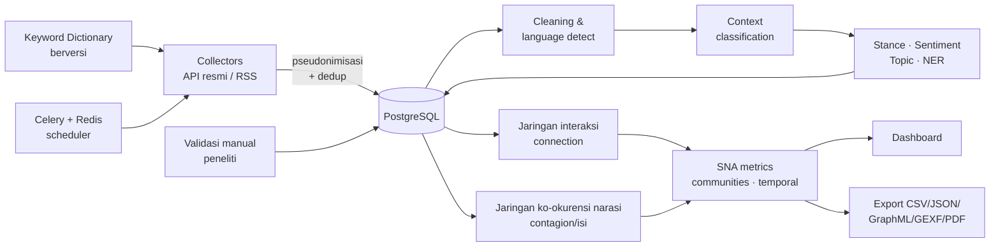

# Arsitektur DRNO

## Modul (terpisah, sesuai Bagian 8)

| Modul | Berkas | Tanggung jawab |
|---|---|---|
| Pengumpulan | `drno/collectors/` | Konektor resmi, rate limit, backoff, dedup, audit |
| Kamus | `drno/keywords.py` | Versi, varian, Boolean, usulan semantik |
| NLP | `drno/nlp.py` | Cleaning, bahasa, konteks, stance, sentimen, BERTopic |
| Jaringan | `drno/sna.py` | Konstruksi graf, metrik, komunitas, temporal, ekspor |
| Privasi | `drno/privacy.py` | HMAC pseudonim, hash konten, retensi |
| API | `drno/api.py` | FastAPI untuk dashboard |
| Scheduler | `drno/tasks.py` | Job terjadwal |

## Prinsip data tiga lapis

1. **Fakta teramati** — `post`, `interaction` (setiap edge punya `post_id` bukti).
2. **Hasil mesin** — `machine_annotation` (label, confidence, model, versi; `is_uncertain` otomatis).
3. **Interpretasi peneliti** — `manual_annotation`, `researcher_memo`.
Dashboard selalu menampilkan dari lapis mana sebuah angka berasal.
